# FADDAN | Field Companion

**Flutter client for a supervised strawberry scouting and spot-treatment rover.**

FADDAN turns row-by-row crop observations into mission summaries, a three-layer field map, human review and traceable reports. This repository contains the first interactive client prototype for the graduation project, built from scratch in Flutter and Dart.

> **Prototype status:** all farms, observations and treatment records are simulated. There is no API or robot connected. Role selection is a demo, not authentication. Robot motion and spray commands are intentionally disabled. This is not agronomic advice, an operational safety system or certification software.

| Release | Platforms in this repository | Verification |
|---|---|---|
| 0.1.0 prototype | Flutter source for Android + Web, compiled Web bundle | 12 tests passing, analyzer clean, Chrome interaction checks |

## العربية: أجربه إزاي؟

نسخة الويب **مش مشروع ويب منفصل**. هي نفس كود Flutter الموجود في `lib/`، واتعمل له compile عشان يشتغل في المتصفح. مش محتاج تكون web developer ولا تتعلم React أو JavaScript عشان تعدل الشاشات. عدّل Dart كالمعتاد وبعدها ابني نسخة الويب من جديد.

- لو Flutter عندك: شغّل `flutter pub get` وبعدها `flutter run -d chrome`.
- لو عايز تجرب النسخة المبنية بدون Flutter: افتح terminal في فولدر المشروع وشغّل `python -m http.server 8080 --directory web_preview`، وبعدها افتح `http://localhost:8080`.
- على Windows لو `python` مش معروف، جرّب `py -m http.server 8080 --directory web_preview`.
- متفتحش `index.html` بدبل كليك. التطبيق محتاج local HTTP server، مش `file://`.
- عشان APK: وصل موبايل أندرويد مع USB debugging، شغّل `flutter run`، أو استخدم `flutter build apk --release`.
- البيانات تجريبية بالكامل، ومفيش رش أو حركة روبوت من التطبيق. اختار **Agronomist** لتجربة حفظ مراجعة محلية.

## Screenshots

These are captures of the running Flutter application, not design mockups. The layout changes from bottom navigation on phones to a sidebar on desktop.

<table>
<tr><td align="center"><b>Role entry</b><br>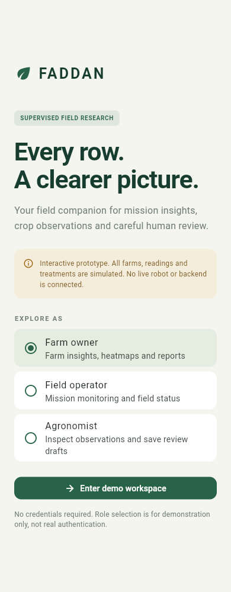</td><td align="center"><b>Overview</b><br>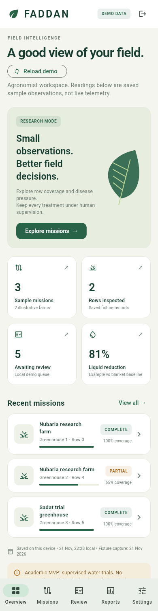</td><td align="center"><b>Mission library</b><br>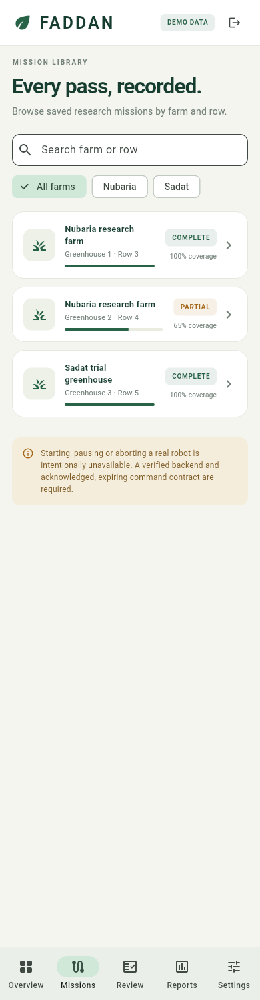</td></tr>
<tr><td align="center"><b>Mission detail</b><br>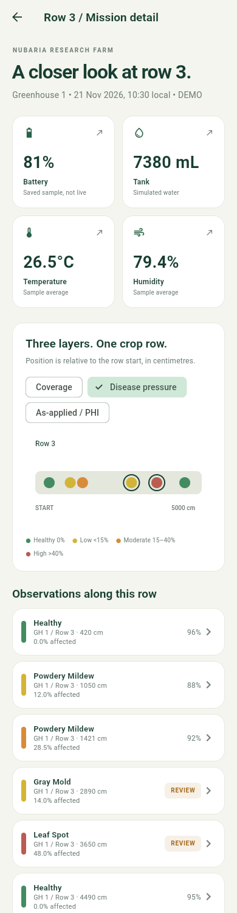</td><td align="center"><b>Observation detail</b><br>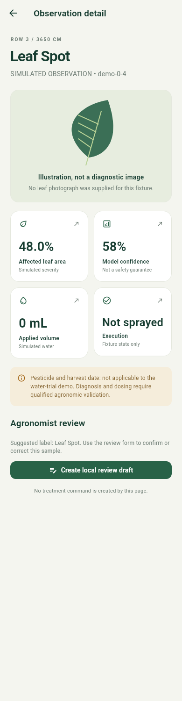</td><td align="center"><b>Human review</b><br>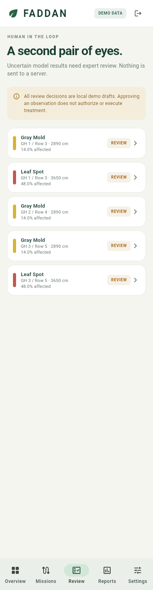</td></tr>
<tr><td align="center"><b>Local review draft</b><br>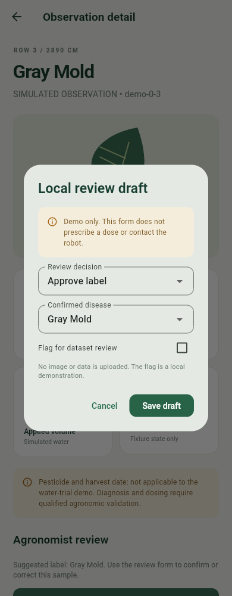</td><td align="center"><b>Reports</b><br>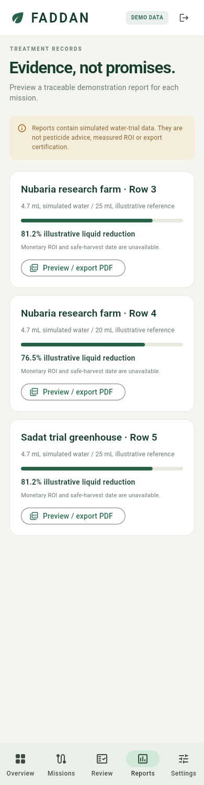</td><td align="center"><b>Settings</b><br>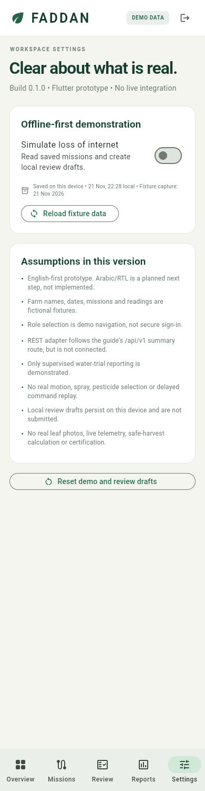</td></tr>
</table>

### Desktop workspace

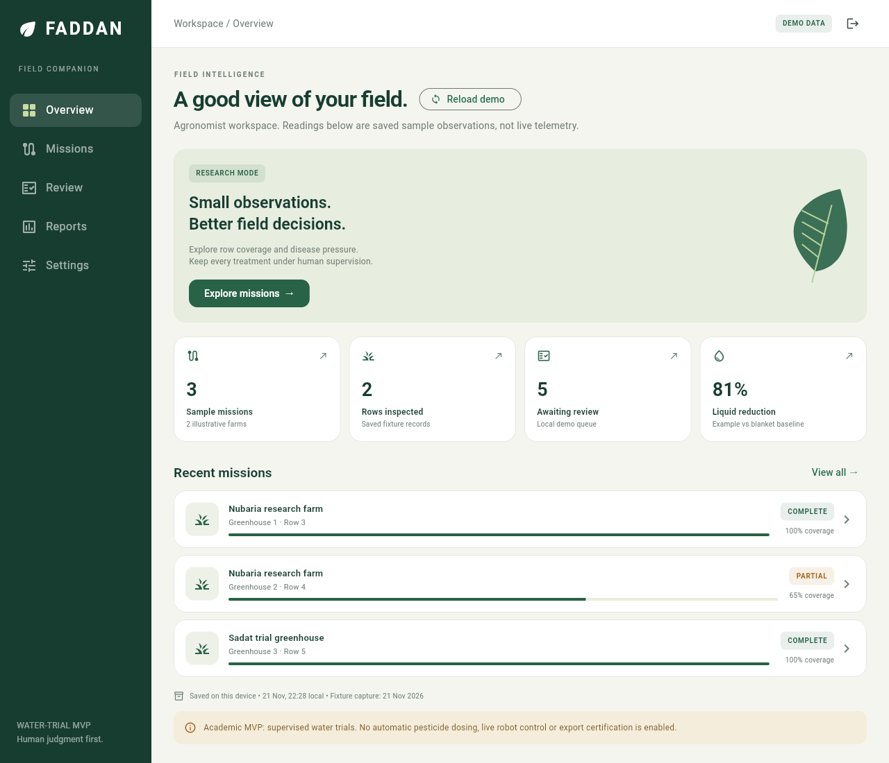

### Draft persistence after a page reload

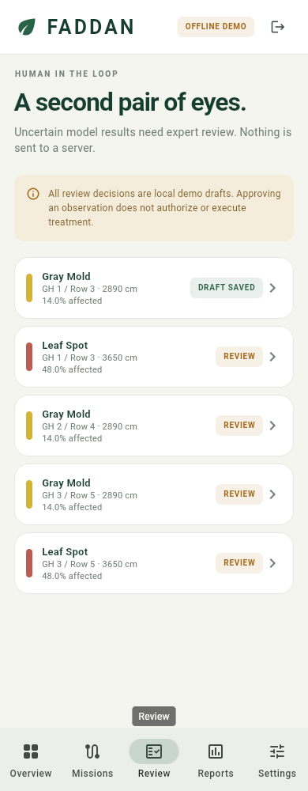

[Open a sample generated PDF](docs/sample-report.pdf).

## What you can try

- Enter as farm owner, field operator or agronomist without credentials.
- Browse three fixture missions across two illustrative farms. Search by farm or row and filter by farm.
- Inspect coverage, battery, tank, temperature and humidity samples. These are saved readings, not live telemetry.
- Switch the row-relative map between **coverage**, **disease pressure** and **as-applied / PHI**. Positions are centimetres from the row start, not GPS coordinates. No pesticide PHI or safe-harvest date is calculated.
- Open an observation to inspect its simulated disease label, affected area, model confidence and water application record. The leaf illustration is explicitly not a diagnostic photograph.
- As agronomist, approve/reject a sample label, correct its disease name or request more evidence in a **local draft**. Nothing is uploaded and no treatment command is created.
- Turn on offline simulation and reload the page. Cached missions, offline settings and drafts persist in local storage. Demo role selection is deliberately not remembered.
- Generate and print/save a PDF report with the same fixture data as the mission view.
- Reset local demo data and drafts in Settings.

## Run from source

### Prerequisites

The checked build used **Flutter 3.50.1 stable / Dart 3.14.0**. The package requires Dart 3.14 or later in the compatible major version. Use `flutter --version` to check your installation. Keep `pubspec.lock` when reproducing this build.

For Chrome: Flutter SDK + Chrome. For Android: Android Studio/SDK, Java compatible with the Flutter toolchain, and a physical device or emulator. Run `flutter doctor -v` and fix Android toolchain issues on your machine.

```bash
flutter pub get
flutter analyze
flutter test --concurrency=1
flutter run -d chrome
```

For an Android device, enable Developer options and USB debugging, connect it, then:

```bash
flutter devices
flutter run
```

No `.env`, backend URL, credentials, API key or Firebase project is required for this prototype.

## The Web version, explained for Flutter developers

`lib/` is the single source of truth for both Android and Web. Flutter compiles Dart into browser assets and renders the same widgets in Chrome. `web/` contains the small web launcher and manifest, not a separate web application.

`web_preview/` is the **already compiled** release bundle included in this same repository. You can serve it without installing Flutter:

```bash
python -m http.server 8080 --directory web_preview
```

Alternatively, run the included helper with `python scripts/serve_web.py` (it binds only to this computer by default).

Open **http://localhost:8080** in Chrome. Stop the server with Ctrl+C. If port 8080 is occupied, use 8081 and open that port instead. Python 3 is required for this command. This server is for local demonstration, not production hosting.

To try it from a phone on the same trusted Wi-Fi, serve on your laptop and open `http://YOUR_LAPTOP_LAN_IP:8080` on the phone. Your firewall must allow that connection. Do not expose this development server to the internet. Separate browsers and devices have separate local drafts.

### Rebuild after editing Dart

```bash
flutter build web --release --no-web-resources-cdn
```

The fresh output is in `build/web/`. The committed `web_preview/` does **not** update automatically. Replace its contents with the contents of `build/web/` before sharing a new compiled version. The no-CDN flag bundles renderer resources locally. Fonts are also bundled in assets.

A local first load with external hosts blocked was tested in Chrome. This does not mean an unopened website can launch without a server or without downloading its app files. The offline switch demonstrates cached data behavior, not background sync or a production service-worker guarantee.

This repository is private. No hosted website or GitHub Pages deployment has been configured. Sharing the repo link does not grant teammates access; the owner must add intended collaborators or share an approved export.

## Build an Android APK

```bash
flutter doctor -v
flutter pub get
flutter build apk --release
```

Output: `build/app/outputs/flutter-apk/app-release.apk`.

For smaller per-architecture APKs:

```bash
flutter build apk --release --split-per-abi
```

Use the `arm64-v8a` build for most current Android phones, or match the device architecture. Approve Android SDK licenses with `flutter doctor --android-licenses` if requested. Initial builds download Gradle and Android artifacts and can take time.

**Important:** the generated Android release configuration currently uses the development/debug signing key. It is suitable only for prototype testing. Configure a private release keystore and proper application ID before distributing a production release. Never commit keystores or signing passwords.

An APK is **not** included: compilation here stopped when the Gradle process terminated, including with reduced heap and worker settings. The Android source and instructions are included, but Android runtime behavior has not been device-tested. If Gradle runs out of memory on your machine, close other heavy processes or adjust `org.gradle.jvmargs` and worker settings in `android/gradle.properties` for your available RAM.

## Architecture

```text
Flutter widgets
    |
    v
AppCubit / AppState
    |                 |
    v                 v
MissionRepository     CacheStore
    |                 |
    v                 v
DemoMissionRepository HiveCache
    |
    v
JSON fixtures -> MissionDto -> Mission / Detection

Unconnected production seam:
FaddanApi -> HTTP client + AuthStore (secure storage)
```

| Area | Location | Responsibility |
|---|---|---|
| Bootstrap | `lib/main.dart` | Open Hive, load cache, provide Cubit |
| App/UI | `lib/app/faddan_app.dart` | Responsive shell, navigation and prototype screens |
| Domain | `lib/features/missions/domain/` | Mission/detection models and severity boundaries |
| Data | `lib/features/missions/data/` | DTO mapping, fixture repository, reserved API adapter |
| State | `lib/features/missions/presentation/` | Demo role, cache refresh, offline simulation, draft state |
| Persistence | `lib/core/cache.dart` | Storage abstraction with Hive implementation |
| Auth seam | `lib/core/auth_store.dart` | Secure token adapter, unused by demo role selection |
| Reports | `lib/features/reports/` | PDF byte generation and platform print/export |
| Tests | `test/` | Domain, persistence, PDF and responsive widget checks |
| Compiled web | `web_preview/` | Release assets, served as static files |

The first version separates domain, DTOs, repository and persistence, while keeping the screen widgets together for easier prototype review. Splitting the UI into smaller feature files is a sensible next refactor; this is not presented as a completed production architecture.

### Data rules

- Healthy: 0%; low: greater than 0 and less than 15%; moderate: 15–40% inclusive; high: above 40%.
- Model confidence is not a treatment safety guarantee.
- Applied-water summary totals equal the sum of fixture observations.
- Liquid-reduction percentages use an illustrative baseline, not measured farm ROI.
- Missing telemetry is shown as unavailable, not fabricated.
- Local role checks protect demo interactions only. The server must enforce real authorization.
- No offline command replay, pesticide prescription, real robot command, harvest guarantee or export-certificate claim is implemented.

### Backend integration boundary

There is **no real API yet**. The default repository is fixture-backed. `FaddanApi` contains only a reserved authenticated summary read at `/api/v1/missions/{id}/summary`, matching the reviewed current guide. It is not selected at startup. Listing, sign-in, review submission, WebSocket, control and rejection endpoints are not invented.

Before integration, agree one versioned contract with the backend team, including pagination, errors, UTC timestamps, nullable telemetry, review status semantics, image access and command acknowledgements. The reviewed materials contain older `/api/.../report` routes and a newer `/api/v1/.../summary` shape. Do not mix them. Hardware battery and safety limits must come from the actual hardware design, not old diagrams.

## Verification record

- `flutter analyze`: **no issues found**.
- `flutter test --concurrency=1`: **12 tests passed**.
- Chrome: entry, mission navigation, empty search/reset, all three map layers, local review save, and offline/draft persistence across full page reload checked.
- Screens visually checked at 320px, 390px and 1280px widths. Narrow layouts were corrected before handoff.
- PDF generated from the fixture, opened and inspected as a one-page report.
- First web load checked with external hosts blocked; JavaScript error list was empty.
- Not verified: native Android/iOS runtime, real network APIs, real authentication, robot operation, production sync and browser installation behavior. Browser printing depends on the browser's print UI.

## Team workstreams

Project workstreams reflected in the planning board reviewed for this prototype:

| Team member | Workstream |
|---|---|
| Youssef "Ordy" Ibrahim | Mobile app + simulation |
| Yousef Walid | Hardware |
| Omnia | Backend |
| Mazen | Simulation |

This repository covers the Flutter client prototype. It does not claim to implement the team's backend, robot firmware, YOLO inference pipeline or simulation engine.

## Next milestones

1. Team review of the prototype and agreement on one backend contract.
2. Real authentication, server-side role enforcement and connected repositories.
3. Real mission/image data, retry/error states and conflict-aware review submission.
4. Arabic/RTL localization and accessibility/device testing.
5. Native Android build validation and production signing.
6. Only after explicit safety design and hardware validation: separate, acknowledged robot-control workflows.

## Project notes

English-first UI. The provisional FADDAN name and simple leaf mark remain in this version; alternative branding is outside this code handoff. No project-wide open-source license has been chosen. Keep third-party license notices when distributing; the bundled Roboto font license is in `assets/fonts/Roboto_LICENSE.txt`.
